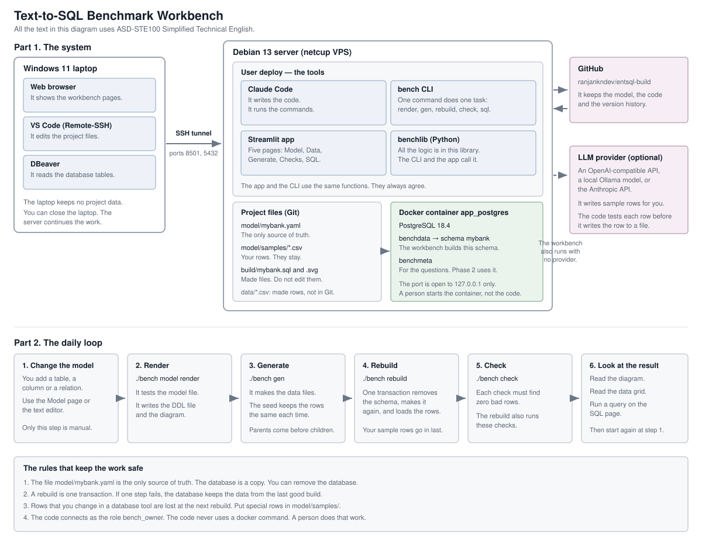

# Architecture

This document uses ASD-STE100 Simplified Technical English. The sentences are
short. Each sentence gives one idea. The words have one meaning only.

## 1. What this project makes

This project makes a benchmark for text-to-SQL systems. The benchmark has
database schemas, synthetic data and questions. Each question has a correct
SQL answer.

The schemas look like enterprise systems. They have short names. The names are
not consistent. Many relations have no declared foreign key. Code columns get
their meaning from lookup tables.

The workbench is the tool that makes these schemas and this data.

## 2. The parts of the system

### 2.1 The laptop

The laptop runs Windows 11. The laptop shows the work. The laptop keeps no
project data.

You use three programs on the laptop:

- A web browser. It shows the workbench pages.
- VS Code with Remote-SSH. It edits the project files on the server.
- DBeaver. It reads the database tables.

All three programs connect through an SSH tunnel.

### 2.2 The server

The server is a netcup VPS. The server runs Debian 13. The user `deploy` does
all the work.

The server runs these tools:

| Tool | Function |
|---|---|
| Claude Code | It writes the code. It runs the commands. |
| `bench` CLI | One command does one task. |
| Streamlit app | It gives five pages for the daily work. |
| `benchlib` | It holds all the logic. The CLI and the app call it. |

The app and the CLI call the same functions. Therefore they always agree.

### 2.3 The database

PostgreSQL 18.4 runs in the Docker container `app_postgres`. A person starts
this container. The project code never starts it.

The container holds two databases for this project:

- `benchdata`. It holds the schema `mybank`.
- `benchmeta`. Phase 2 uses it for the questions.

The database port is open to the address 127.0.0.1 only. No person can reach
the port from the internet.

### 2.4 The optional LLM provider

An LLM provider writes sample rows for you. The provider is optional. The
workbench runs correctly with no provider.

You can use one of these providers:

- An API that is compatible with OpenAI, for example OpenRouter.
- A local Ollama model.
- The Anthropic API.

The code tests each row before it writes the row to a file. A weak model gives
more rejected rows. A weak model cannot give bad data.

## 3. The files

| File or directory | Function |
|---|---|
| `model/mybank.yaml` | The only source of truth. It holds the tables, the columns, the relations and the generation rules. |
| `model/samples/*.csv` | Your rows. The rebuild loads them after the made rows. |
| `build/mybank.sql` | The DDL file. The `render` command makes it. Do not edit it. |
| `build/mybank.svg` | The model diagram. The `render` command makes it. |
| `data/*.csv` | The made rows. Git does not keep them. The seed makes them again. |
| `versions/` | One copy of the model for each version. |
| `checks/generated/` | The checks that the model makes. |

Git keeps all these files except `data/*.csv`. GitHub keeps the history.

## 4. The daily loop

Do these six steps in this sequence.

1. **Change the model.** Add a table, a column or a relation. Use the Model
   page or the text editor. Only this step is manual.
2. **Render.** Run `./bench model render`. The command tests the model file.
   Then it writes the DDL file and the diagram.
3. **Generate.** Run `./bench gen`. The command makes the data files. The seed
   keeps the rows the same. The command makes the parent rows before the child
   rows.
4. **Rebuild.** Run `./bench rebuild`. One transaction removes the schema,
   makes the schema again and loads the rows. Your sample rows go in last.
5. **Check.** Run `./bench check`. Each check must find zero bad rows.
6. **Look at the result.** Read the diagram. Read the data grid. Run a query on
   the SQL page. Then go to step 1 again.

The command `./bench rebuild` does steps 3, 5 and 2 for you. Use the single
commands when you want to see one step only.

Run `./bench status` when you are not sure. The command tells you if the
database agrees with the files.

## 5. The rules

These four rules keep the work safe.

1. The file `model/mybank.yaml` is the only source of truth. The database is a
   copy. You can remove the database.
2. A rebuild is one transaction. If one step fails, the database keeps the data
   from the last good build.
3. Rows that you change in a database tool are lost at the next rebuild. Put
   special rows in `model/samples/`.
4. The code connects as the role `bench_owner`. The code never uses a docker
   command. A person does that work.

## 6. How the design stays flexible

The design has three points of change. Each point needs a new file or a new
setting. No other code changes.

| Point of change | Where | How to change it |
|---|---|---|
| The database server | `bench.toml`, profiles `[db.*]` | Set `BENCH_DB` or use the flag `--db`. |
| The SQL dialect | `benchlib/dialects/` | Add one file. Phase 1 has PostgreSQL only. SQLite and MySQL come later. |
| The LLM provider | `benchlib/llm/`, profiles `[llm.*]` | Set `BENCH_LLM` or use the flag `--llm`. |

## 7. Phase 2

These parts are not built. Build them when you need them.

- Generators for history tables, snapshot tables and fiscal calendars.
- Checks for business rules.
- A test that runs each correct SQL answer and compares the result.
- An export to SQLite. The same query must give the same result on both
  engines.
- A read-only web page for other persons.
